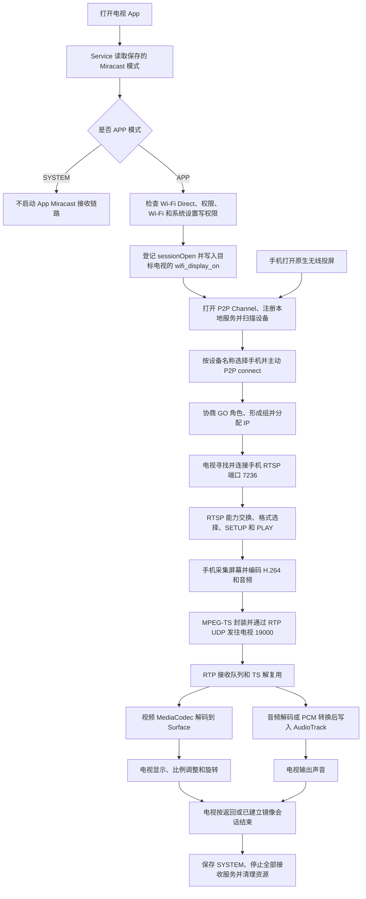

# Android 手机镜像到电视：流程与合理性评估

日期：2026-11-10。审查版本：v1.2.13，代码提交 `7cd37462d20db1ee436b5315bdcad414f1ca934b`。

本报告基于当前源码静态核查，覆盖 Android 手机原生 Miracast/Wi-Fi Display 屏幕镜像。DLNA 视频地址播放、AirPlay 和 Google Cast 是其他路径，不应混用本报告的连接流程。手机端实现不可见，涉及发送端的步骤按协议角色说明；源码注释中的历史实测不能代替本次真机验证。

## 1. 判断

**整体媒体链路合理，适合按需使用、重视低延迟和画面调整的电视接收器；连接发现和能力协商仍偏向特定机型，不能视为通用 Android Miracast 接收器。**

合理的部分是：由 Controller 统一管理模式和 P2P 生命周期；接收和解码分离；直接使用 MediaCodec 输出到 Surface；退出由 Service 统一清理，并保留未清理完的持久化证据。

主要限制是：手机筛选依赖设备名称；Android 自动连接分支不广播 WFD IE；通过扫描 P2P IPv4 网段寻找 RTSP 发送端；视频能力固定声明为 H.264、最高 1080p60；丢包恢复和音画同步较简化。

“手机能连上”“播放清晰”“长时间稳定”“退出后可重新连接”是四个不同的验收目标，应分别验证。

## 2. 完整流程



### 2.1 打开 App 与进入 APP 模式

`CastReceiverService` 启动后初始化各协议接收器，并让 `MiracastController.reconcile()` 按保存的模式对齐。没有保存值时模式为 SYSTEM；上次完整退出已保存 SYSTEM 时，下次启动也保持 SYSTEM。若进程异常结束前保存的是 APP，启动逻辑仍会读取该意图，并处理残留；并非每次启动都无条件覆盖成 SYSTEM。

目前各协议共用启动门槛：Service 先等普通网络获得本地 IP，每 5 秒重试，最多等待 5 分钟后仍尝试启动。这个等待有利于 AirPlay、DLNA 的 mDNS/SSDP 地址绑定，但 Miracast 主要使用 Wi-Fi Direct，自身并不要求手机和电视先处于同一路由器网络。共用门槛可能拖慢离线镜像启动。

用户开启 APP 模式后，Controller 检查：

- 电视是否有 Wi-Fi Direct 管理服务。
- Android 13+ 的附近 Wi-Fi 设备权限，或旧版本的位置权限。
- Wi-Fi 是否开启，以及是否持有 `WRITE_SECURE_SETTINGS`。
- 首次产生副作用前保存 `sessionOpen=true`，再写系统设置、打开 P2P。

旧 Android 上，即使权限已授予，系统定位开关和厂商 Wi-Fi 策略仍可能影响扫描，需要设备验证。

`wifi_display_on=1` 对应 APP、`0` 对应 SYSTEM，是源码记录的目标小米电视适配语义。它不是所有 Android 电视统一的“接收器所有权 API”；读回设置值只能证明写入成功，不能证明每款电视的系统投屏服务已经按预期让出资源或恢复接收。

源码：[Service](../app/src/main/java/com/weekd/miracastreceiver/service/CastReceiverService.kt)、[Controller](../app/src/main/java/com/weekd/miracastreceiver/miracast/MiracastController.kt)、[模式存储](../app/src/main/java/com/weekd/miracastreceiver/miracast/MiracastMode.kt)、[系统设置适配](../app/src/main/java/com/weekd/miracastreceiver/miracast/WifiDisplaySetting.kt)。

### 2.2 手机发现与主动连接

Android 自动连接已作为内部策略开启，旧版保存为 false 的设置也会迁移为 true，界面隐藏该设置行。

当前实际执行的是：

```text
p2p.open()
registerLocalService()
autoConnectAndroid = true
跳过预建 createGroup()
跳过 advertiseWfdIe()
discoverPeers()
```

因此，“内部自动连接开启”和“广播标准 WFD 接收端能力”是不同的事。当前分支不主动设置 WFD IE；注册 `_miracast._tcp` 的 P2P 本地服务，也不能证明所有手机的原生投屏列表会识别这台电视。

设备变化时，App 读取 P2P peers，并选择首个符合名称条件的设备：包含 `oppo`、`vivo`、`xiaomi`、`samsung`、`galaxy` 或 `sm-`。小米设备额外检查部分 WFD 信息，尽量排除接收端电视。

随后调用 `p2p.connect()`，使用 WPS PBC，并设 `groupOwnerIntent=15`，偏向让电视成为组主。每个设备最多尝试 5 次，并有 2 秒间隔过滤；失败回调会解除间隔限制，但尝试次数仍累计。

**合理性：** 不预建自主 GO 组、改用 P2P 协商，是针对目标手机授权路径的兼容办法。但品牌名称不是协议能力，也不能证明该手机正在主动请求镜像；改名、其他品牌、多台同品牌设备都可能影响结果。达到 5 次上限后，当前 manager 生命周期内该设备不会继续尝试，需要重建或重开来恢复尝试。

源码：[Wi-Fi Direct](../app/src/main/java/com/weekd/miracastreceiver/miracast/WifiDirectManager.kt)、[AppSettings](../app/src/main/java/com/weekd/miracastreceiver/util/AppSettings.kt)。

### 2.3 P2P 建组与 IP 分配

`connect()` 接受只表示系统接受了协商请求，不等于镜像已建立。系统之后负责 GO 协商、组形成和 IP 配置；收到 `groupFormed` 后，Controller 通知 WFD 模块立即寻找发送端。

电视通常按策略争取 GO，手机取得组内客户端 IP。若电视成为 P2P 客户端，代码也支持直接尝试 GO 地址。

**需要纠正源码注释：** “电视必须是 GO 才能接收投屏”过于绝对。Source/Sink 表示发送/接收媒体，GO/client 表示无线组角色，这两组角色不同；代码已有电视不是 GO 时的分支。GO=15 是当前偏好的兼容策略，不是接收视频的普遍必要条件。

本流程未显式选择 2.4GHz/5GHz 或信道，实际频段和信道由系统、驱动以及手机共同决定，不能从 App 设置推断链路一定使用 5GHz。

### 2.4 找到手机 RTSP 控制端口

虽然类名叫 `WfdServer`，该 Miracast 路径实际创建的是出站 TCP Socket，主动连接发送端。这里没有在电视启动 Miracast TCP 7236 的 `ServerSocket` 监听。手机是 RTSP 控制连接的监听方，电视连接后双方在同一条连接上交换请求和响应。

电视是 P2P 客户端时先尝试 GO 地址；电视是 GO 时，从 `p2p*` 接口取得 IPv4 前缀，假设 `/24`，扫描 `.2` 到 `.254` 的 7236 端口，每批 32 个并发，单次连接超时 1.5 秒。成功连接直接用于会话，不做“探测后关闭再重连”，这能避免消耗发送端只接受一次的监听连接。

**合理性：** 保留成功 Socket 是正确的兼容措施；全网段扫描属于缺少精确客户端 IP 的补救方式。它依赖接口名、IPv4 网段、端口和地址范围假设，一轮可能耗费数秒，不能把 1 秒的扫描间隔理解为 1 秒一定接通。后续宜优先取得实际组客户端 IP、WFD 控制端口信息或可用的邻居信息，扫描作为退路。

源码：[WFD 会话发起器](../app/src/main/java/com/weekd/miracastreceiver/miracast/WfdServer.kt)。

### 2.5 RTSP 能力协商与启动

当前处理链为：

| 阶段 | 方向 | 内容 |
|---|---|---|
| M1/M2 | 手机与电视互发 OPTIONS | 交换支持的控制方法 |
| M3 | 手机 GET_PARAMETER，电视回复 | 声明视频、音频、接收端口等能力 |
| M4 | 手机 SET_PARAMETER | 选择格式并传入 presentation URL |
| M5 | 手机 SET_PARAMETER | 触发电视发送 SETUP |
| M6 | 电视 SETUP，手机回复 | 指定电视 RTP 接收端口并取得 Session |
| M7 | 电视 PLAY，手机回复 | 标记流启动，打开播放页 |

RTP UDP Socket 在握手前已绑定到电视的 19000，避免 PLAY 之后第一批包到达时尚无接收器。

当前固定视频能力：H.264 High Profile、Level 4.2；CEA 位图 `000001C0` 包含 720p60、1080p30、1080p60。不声明 4K；手机最终选择哪档，应查看 M4 日志和真实码流。音频能力回复仅声明 AAC；底层虽能解析 LPCM，但不代表握手已经向手机声明支持 LPCM。另声明无内容保护、无 EDID、无 UIBC，因此不应承诺受保护视频可镜像，或电视能反向操控手机。

**合理性：** M1–M7 顺序和提前准备 RTP 接收合理。但能力不应长期硬编码为每台电视都支持 1080p60 High Profile。应依据 AVC 解码器 profile/level、尺寸与帧率能力以及机型实测，生成可兑现的能力；低性能电视和旧手机需要兼容档位。

源码：[RTSP 会话处理](../app/src/main/java/com/weekd/miracastreceiver/miracast/WfdSessionHandler.kt)。

### 2.6 手机采集、压缩与发送

手机端将屏幕图像采集并编码，音频与视频封装为 MPEG-TS，再通过 RTP/UDP 发给电视。当前电视接收实现主要面向 H.264 视频与 AAC/LPCM 音频。采集分辨率、编码码率、关键帧间隔、内容旋转及黑边处理由发送端实现决定，App 不能仅靠放大画面提升源数据的细节。

例如，手机可能把竖屏内容放在 1920×1080 的横向编码画布中，两侧是黑边。整个码流是 1080p，但真正手机画面只占其中一部分；裁掉黑边再放满电视，会把这部分像素放大，而不会恢复未发送的细节。

### 2.7 电视接收、解复用与播放

接收线程剥离 RTP 头，将 TS 负载放入容量 256 的队列；解码线程读取队列、解析 PAT/PMT 和 PES。视频交给 `MiracastVideoRenderer`，音频交给 `MiracastAudioPlayer`。

视频先捕获 SPS/PPS，取得实际分辨率，等到 IDR 关键帧后开始解码。复用的 `VideoDecoder` 使用 MediaCodec，并由独立输出线程将解出的帧立即送显。普通画面输出到 SurfaceView；需要旋转、裁切或非原始比例时改用 TextureView。音频在独立线程解析 AAC ADTS 或 LPCM，最终写入 AudioTrack。

**合理性：** 接收与解码分离可以降低解码卡顿对 UDP 收包的影响；MediaCodec 直出 Surface 避免通用点播缓冲，是适合镜像的方向。MediaCodec 是系统解码入口，AVC 当前通过 MIME 选择解码器，不能仅凭调用该 API 保证所有机型都选到合适的硬件解码器。

不走 ExoPlayer 有利于此实现降低延迟，但源码所述“ExoPlayer 延迟超过 10 秒”只应理解为历史配置下的观察，不能推广为 ExoPlayer 的固定延迟。

源码：[RTP 接收](../app/src/main/java/com/weekd/miracastreceiver/miracast/RtpReceiver.kt)、[TS 解复用](../app/src/main/java/com/weekd/miracastreceiver/miracast/TsDemuxer.kt)、[视频渲染](../app/src/main/java/com/weekd/miracastreceiver/miracast/MiracastVideoRenderer.kt)、[解码器](../app/src/main/java/com/weekd/miracastreceiver/airplay/VideoDecoder.kt)、[音频输出](../app/src/main/java/com/weekd/miracastreceiver/miracast/MiracastAudioPlayer.kt)、[播放页面](../app/src/main/java/com/weekd/miracastreceiver/ui/PlayerActivity.kt)。

### 2.8 结束与恢复

v1.2.13 采用用户确定的策略：电视按返回，或已经进入 PLAY 的 Miracast 镜像会话结束，停止全部接收服务并保存 SYSTEM。DLNA 客户端 STOP 只结束本次播放，保留服务待命。播放浮层打开时，返回先关闭浮层。

Service 关闭新播放请求入口，保存 SYSTEM，停止并等待 AirPlay 与 Miracast 清理，再停止其他接收服务，移除前台通知并停止自身。Miracast 清理停止 RTSP/RTP 与音频线程、停止有跟踪证据的 Root/framework IE、撤销 P2P，并写回目标系统设置。清理失败时保留 `sessionOpen=true`。

握手未进入 PLAY 的失败没有直接当作用户结束镜像，会尝试恢复 P2P；单纯 P2P 丢组也有重建路径。已经进入播放的 RTSP 断开或读超时则会结束镜像并触发整体退出。由此，网络故障也可能与手机主动停止产生相同退出效果；当前没有可靠区分所有断开原因。

**合理性：** 明确退出和可等待清理符合按需使用目标。但“镜像结束不待命”意味着短暂断网也可能要求用户重新开启 APP 模式，这是目前策略的实际取舍。切 SYSTEM 表示释放本 App 的 Miracast 接收资源，不保证每个固件的系统接收器会自动开启。

## 3. 清晰度、流畅度与延迟

| 环节 | 当前影响 | 如何判断 |
|---|---|---|
| 能力协商 | 固定最高 1080p60，手机可选更低档 | 查看 `WFD: negotiated mode` 与 M4 格式 |
| 实际编码 | 码率、采集分辨率、关键帧间隔由手机决定 | 查看 SPS/解码器输出尺寸，结合运动画面 |
| 竖屏内容 | 编码画布可能已有黑边，放大后有效像素不足 | 对比全画布尺寸与实际内容区域 |
| Wi-Fi Direct | 干扰、频段、丢包影响卡顿和错误恢复 | 查看 RTP 序号跳变，结合无线链路信息 |
| 队列与解码 | 解码跟不上会积压或丢数据 | 记录队列峰值、解码丢帧和输出帧率 |
| 渲染变换 | TextureView 旋转/缩放有额外合成开销，放大无法增加细节 | 对比原始 SurfaceView 与变换模式 |
| 音画同步 | 当前倾向收到即播，没有统一 PTS 播放时钟 | 长时间口型/节拍测试与延迟测量 |

播放页的 `applyQuality()` 调整 ExoPlayer TrackSelector，不会改变这条 Miracast 编码链路，也不能让手机从 720p 自动变成 1080p。

当前信息面板的 Miracast“码率”由 RTP 接收总字节数换算，包含音频、TS 和 RTP 开销，属于接收流总吞吐估算，不能直接当作纯视频编码码率。镜像帧率目前没有计数，面板不会给出真实解码 FPS。显示尺寸读取逻辑也没有完整区分 Miracast 的实际 Surface/Texture 变换目标，不宜用该指标证明像素一一对应。

1080p60 比 1080p30 更流畅，PES 等待下一单元时的帧间隔也更短；但 60fps 会提高编码、无线和解码负担。在同一码率预算下，每帧平均可用数据更少，不代表清晰度一定更高。

## 4. 仍需改进的实现与优先级

以下为本次发现和建议，**尚未作为修复提交，也没有改变 v1.2.13 APK**。P1 表示建议下一轮优先处理，不表示已经有真机故障证据。

| 优先级 | 发现 | 影响与建议 |
|---|---|---|
| P1 | AVC 解码器丢输入帧或进入错误状态后，Miracast 渲染层未读取 `isHealthy`，也没有收到丢帧反馈 | 参考帧缺失后可能花屏，错误状态可能持续。应反馈到关键帧等待逻辑，并在错误状态重建解码器 |
| P1 | SPS/PPS 捕获后不再更新 | 手机动态改变编码参数时可能不能正确重配置。应检测参数变化并按新尺寸重建 |
| P1 | 声明的 profile/level/1080p60 能力与硬件检测脱节 | 应结合 CodecCapabilities 和目标机型表现生成能力，保留合理低档位 |
| P1 | 品牌名称筛选与无主动 WFD IE 广播 | 不保证改名或其他品牌可发现/连接。先验证现有目标机型，再增加协议能力识别；在有系统权限的机型上评估标准广播 |
| P2 | RTP 序号不连续直接当作丢包 | 迟到、重复或乱序也会被算作损失；模 65536 运算可能出现巨大假丢包值。增加小窗口分类/重排，并避免重复触发视频恢复 |
| P2 | 无统一音视频时钟 | 音频 PES PTS 被丢弃，视频立即显示。“各自低延迟”不能保证长期同步。以音频播放位置为参考，设计有上限的校正 |
| P2 | UDP 队列按包数限制，没有按时间限制 | 256 包在不同码率下代表不同延迟；丢最旧包也可能丢掉参考数据。应统计排队时长，明确延迟预算和恢复策略 |
| P2 | 丢包后只等待下一关键帧，没有此路径的主动关键帧请求或 RTCP 反馈 | 恢复时间受手机关键帧间隔限制。先统计恢复时长，再评估发送端支持的反馈方式 |
| P2 | IPv4 `/24` 扫描与固定 7236 | 不够精确，增加连接时间；优先实际客户端地址和可用控制端口信息 |
| P2 | 镜像与其他协议共用普通网络就绪等待 | 离线 P2P 使用可能被拖慢；分离 Miracast 启动条件，同时保持 mDNS/SSDP 地址正确 |
| P2 | 镜像“码率/帧率/显示尺寸”指标有限 | 调试易把总接收吞吐、编码尺寸、显示尺寸混淆。补充实际 FPS、有效内容区域和排队时长 |
| P3 | LPCM 解码存在，但协商只声明 AAC | 兼容面受声明限制。先验证 LPCM 路径，再评估向发送端声明支持 |
| P3 | TS 能识别 HEVC PID，但 Miracast 视频渲染仍按 AVC 初始化 | 当前正常声明仅为 AVC，因此不是已支持 HEVC 的证明；应明确拒绝不支持格式或完整接通 HEVC |
| P3 | 部分注释仍写电视 7236 监听、必须是 GO、用户退出后重新待命 | 与现有实现及产品策略不一致；后续整理注释，避免据此设计新改动 |

不建议当前直接把能力改成 4K 或把缓存扩大：前者尚无此 Miracast 路径的硬件/链路验证，后者可能让延迟变大而掩盖吞吐问题。

## 5. 建议验收矩阵

| 场景 | 必须确认的结果 |
|---|---|
| OPPO/Vivo/小米/Samsung，记录具体型号与系统版本 | 从手机打开投屏到首帧的各阶段耗时、实际分辨率和音频格式 |
| 手机改名、两台同品牌手机同时扫描、其他品牌 | 是否发现正确设备，是否出现错误连接或无法再次尝试 |
| 电视只有 Wi-Fi 开启但没有路由器网络 | P2P 是否能独立使用，是否被网络等待阻塞 |
| 720p/1080p、30/60fps、静态文字/快速运动 | 真实输出尺寸、FPS、吞吐、队列峰值、视觉错误 |
| 竖屏/横屏切换、裁黑边、手动旋转、比例调整 | SPS 是否变化、Surface 切换是否黑屏、缩放后的有效清晰度 |
| 弱信号、无线干扰、短暂断网 | 区分乱序/丢包，记录等待关键帧时间及整体退出行为 |
| 持续播放 30–60 分钟，使用口型或节拍素材 | 音画偏差是否随时间积累、内存和队列是否增长 |
| 手机停止镜像、电视按返回、连续重复操作 | 全部服务停止、SYSTEM 已保存、音频停止、P2P/IE 清理；再次手动 APP 能重连 |
| DLNA 客户端 STOP 后再次播放 | 保持服务待命，不被镜像退出逻辑影响 |
| 强制结束进程后再开 App | 根据持久化证据处理残留，不把未完成清理标记为成功 |

已有验证记录：v1.2.13 的 65 项 JVM 测试和 Release 构建（含 lintVitalRelease）通过；完整 lintRelease 存在历史问题。它们不覆盖手机发现、无线链路、真实解码器、音画同步和电视固件对系统设置的语义。本报告阶段未连接电视或手机执行新实测。

## 6. 建议下一轮顺序

1. 先补真实协商格式、实际解码 FPS、队列时长和断开原因等观测，取得目标手机与电视日志。
2. 修正 Miracast 解码错误恢复、输入丢帧反馈和 SPS/PPS 变化处理。
3. 依据硬件能力与真机结果调整视频能力，先保证可持续的 1080p，再评估更高规格。
4. 完善 RTP 乱序/丢包分类与小幅音画校正。
5. 最后扩大手机发现兼容范围并缩短寻找 RTSP 端口的时间。

当前按需 APP/SYSTEM 生命周期可以保留。清晰度提升应从手机实际发送的有效像素和编码质量入手，稳定性提升应从可观测的接收、解码与恢复路径入手。
